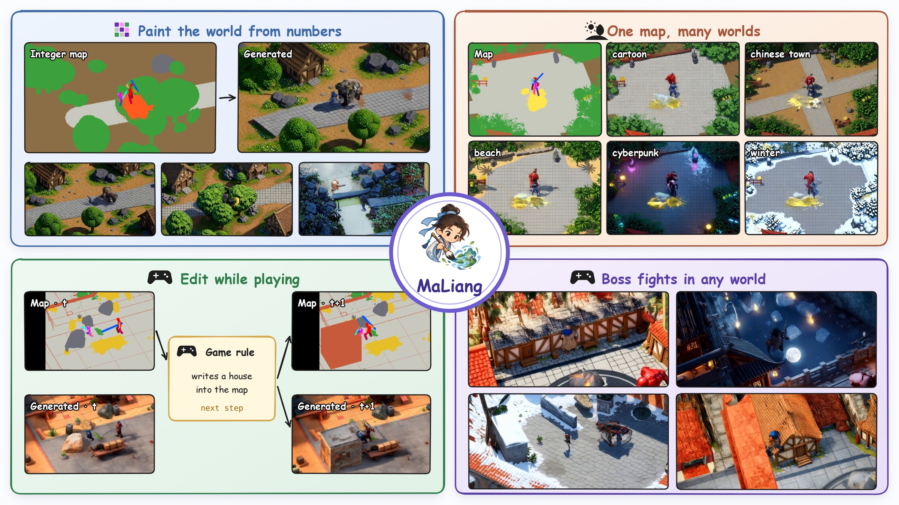
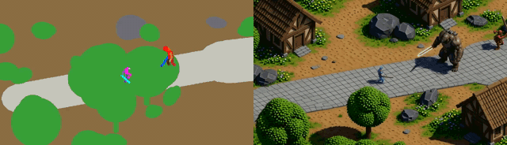
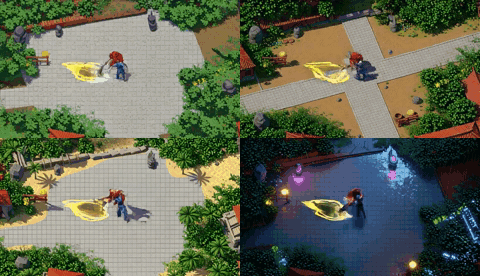
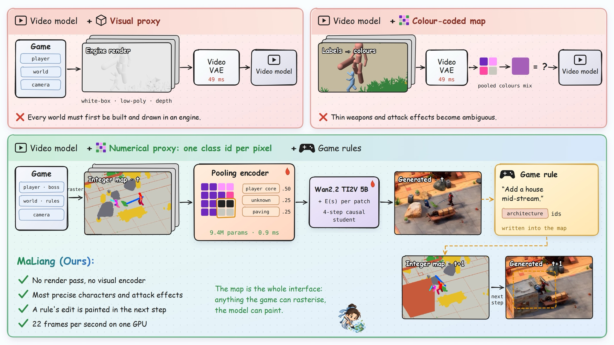
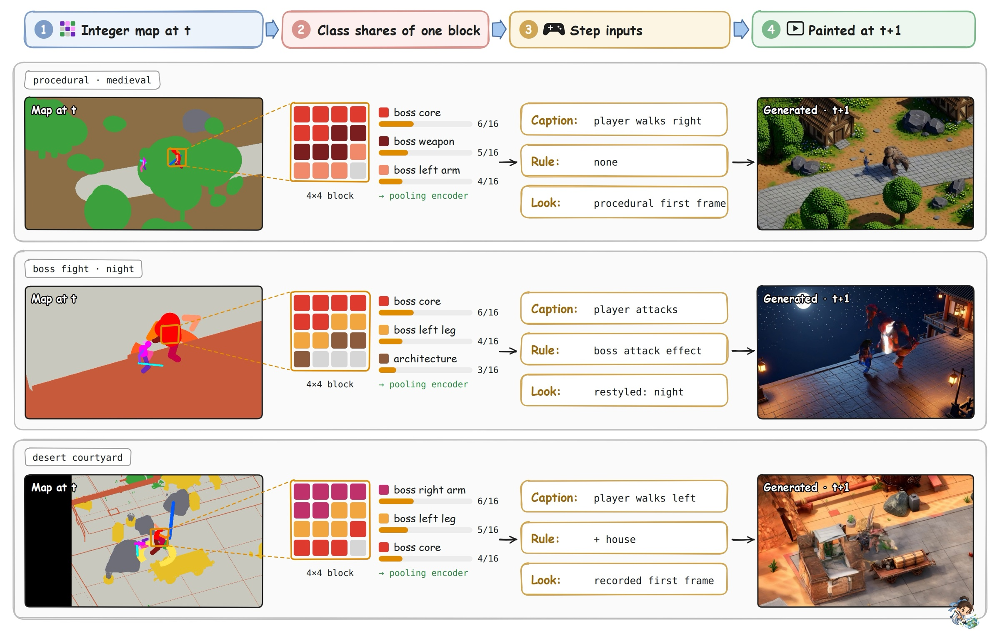
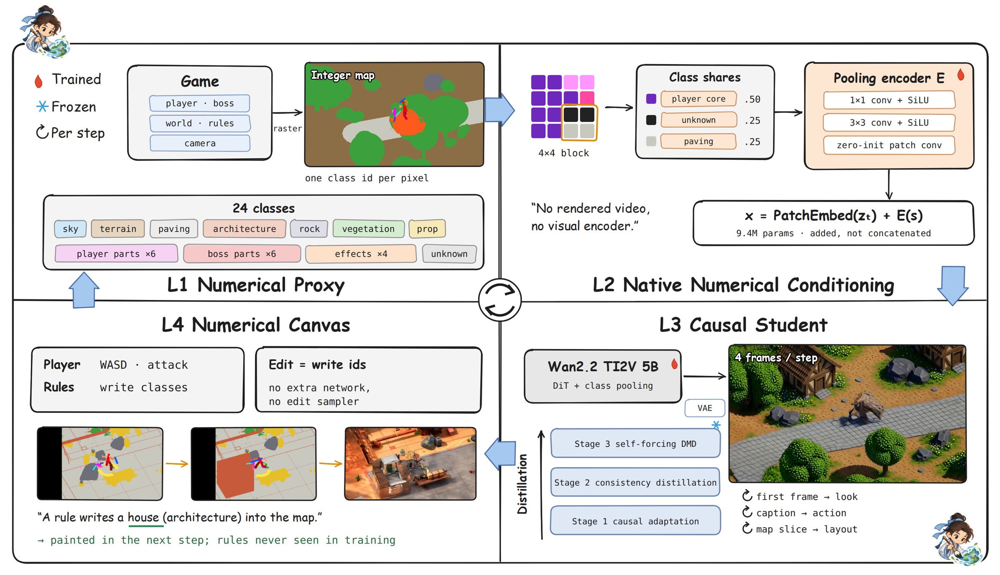
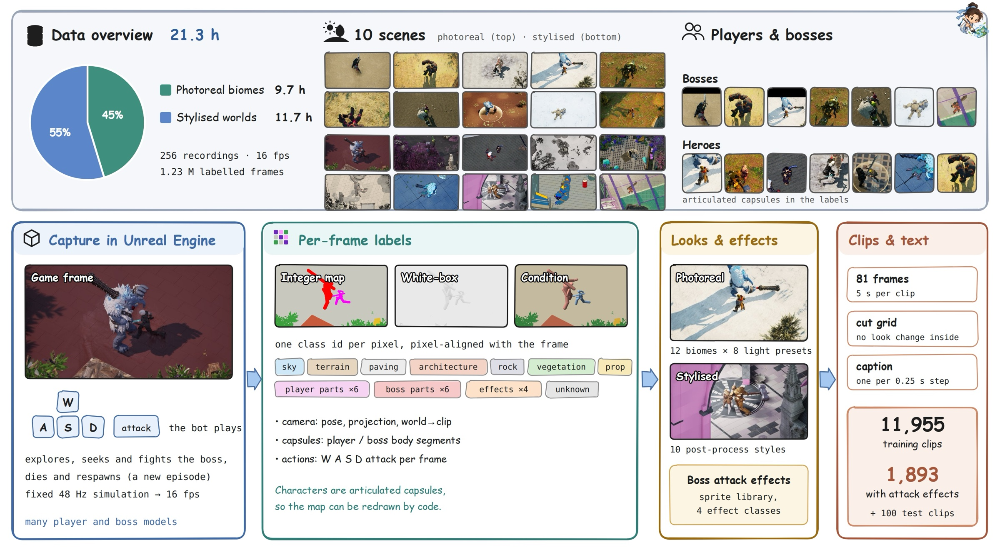

<div align="center">


# MaLiang: Painting Playable Game Worlds from Numbers

[Zhiyang Deng](https://teawhite.cn/)<sup>1,2,\*</sup> · [Shushan Xu](https://github.com/sylvana20)<sup>1,3,\*</sup> · [Yeying Jin](https://github.com/jinyeying)<sup>1,2,♢</sup>

<sup>1</sup>Tencent · <sup>2</sup>National University of Singapore · <sup>3</sup>Nanyang Technological University
<br><sup>\*</sup>Equal contribution · <sup>♢</sup>Corresponding author and project leader

[](https://sylvana20.github.io/maliang/)
[](https://huggingface.co/15y6u87/MaLiang)
[](https://huggingface.co/datasets/15y6u87/MaLiang-Data)
[](LICENSE)



**A game hands a video model one integer per pixel. The model paints the world, live.**<br>
Watch the video and the interactive examples on the [project page](https://sylvana20.github.io/maliang/).

</div>

## 🎬 Demo Results

<div align="center">
<table>
  <tr>
    <td align="center"><br><sub>Integer map → generated world</sub></td>
    <td align="center"><br><sub>One fight, four first frames</sub></td>
  </tr>
  <tr>
    <td align="center"><br><sub>A rule writes a house into the map</sub></td>
    <td align="center"><br><sub>Recorded map · cyberpunk</sub></td>
  </tr>
  <tr>
    <td align="center"><br><sub>Boss fight · night</sub></td>
    <td align="center"><br><sub>Boss fight · courtyard</sub></td>
  </tr>
</table>
</div>

> Every frame above is generated by the real-time causal student at 832×480 from the integer map shown or used; the first frame sets the look.

## 🔥 News

- **Nov 2026**: 🎉 We release the training, distillation, inference and evaluation code, the five checkpoints of the paper, and the raw training recordings.

## 🌍 Overview

Video models now render game footage of remarkable quality, and recent systems use them as the renderer of an
executable game: a simulator keeps the world state and rules, and the video model paints the frames. Most connect
the two through a visual proxy (white-box, low-poly or colour-coded video encoded by a video autoencoder), so every
world must first be built and drawn in an engine. **MaLiang removes this detour.** Its *numerical proxy* is a
per-pixel integer map of the whole world, including characters, body parts and attack effects; *native numerical
conditioning* adds it to a Wan2.2-TI2V-5B video diffusion transformer through a 9.4M-parameter class-pooling
encoder, with no rendered video and no visual encoder; and the map becomes a *numerical canvas* that game rules edit
and the model paints.

<div align="center"><br><em>A visual proxy and a colour-coded map against MaLiang's numerical proxy. All images are real; (c) is a real-time rollout where a rule adds a house to the map.</em></div>

## ✨ Highlights

- **Numbers in, world out.** The game rasterises its state into one class id per pixel; a class-pooling encoder turns each 4×4 block into class shares that are added to the patch embedding. No render pass, no visual encoder.
- **Precise characters and effects.** With backbone and data fixed, integer conditioning matches colour-coded inputs in image quality and controls layout, characters and attack effects more precisely, even against a colour encoder of identical cost.
- **Real time.** Distilled into a four-step causal student (teacher forcing → consistency distillation → DMD), MaLiang streams at 22 frames per second on one GPU.
- **Edit while playing.** Anything the game writes into the map, such as a house, a wall, a boss clone or a rock, is painted in the next step; one map can be replayed from any first frame to give a new world.
- **Strong results.** On held-out recordings MaLiang reaches lower FVD (154 vs. 391) than the strongest off-the-shelf renderer, a 33B model, at statistically tied semantic accuracy.

<div align="center"><br><em>Three steps of the real-time model: the integer map, the class shares of one block, the step inputs and the painted next step.</em></div>

## 🏗️ Method

<div align="center"><br><em>The four-layer closed loop: numerical proxy (L1), native numerical conditioning (L2), causal student (L3) and numerical canvas (L4).</em></div>

## 📦 Model zoo

All checkpoints are bf16 safetensors, `vocab=parts_fx`, resolution 832×480, hosted on
[Hugging Face](https://huggingface.co/15y6u87/MaLiang):

```bash
pip install -U huggingface_hub
hf download 15y6u87/MaLiang --local-dir models
cd models && sha256sum -c models.sha256 && cd ..
```

| File | Role | Metadata |
| --- | --- | --- |
| `sft_fxcond_v1_step-10667.safetensors` | Bidirectional teacher | 831 keys, 10,667 SFT steps; teacher referenced by the deploy checkpoint |
| `fxcond_v1_stage3_ema_step500.safetensors` | Deployed causal student | 831 keys, stage-3 DMD EMA 500, 4-step; used for the paper's real-time table |
| `abl_color_vae_step-5000.safetensors` | Ablation ①: coloured video → Wan VAE | 827 keys, `cond_mode=color_vae`, step 5000 |
| `abl_color_light_step-5000.safetensors` | Ablation ②: coloured video → light encoder | 831 keys, `cond_mode=color_light`, step 5000 |
| `abl_v3_ids_step-5000.safetensors` | Ablation ③/④: integer map → `gc_sem_cond` | 831 keys, step 5000; step-5000 snapshot of the same SFT run as the teacher |

`models.sha256` lists the SHA-256 of each released file.

## 📁 Repository layout

```
maliang/
├── code/
│   ├── gc25d/                 # model, SFT, inference, preprocessing
│   │   ├── model.py           # SemCondEncoder + gc_forward
│   │   ├── train.py           # bidirectional SFT
│   │   ├── infer.py           # clip / user / batch inference
│   │   ├── sample.py          # teacher evaluation on val clips
│   │   ├── sample_user.py     # own first frame + ids + prompts
│   │   ├── prep_v10.py        # raw recordings -> latents / cond / meta
│   │   ├── procmap.py         # procedural unseen maps
│   │   └── gcdistill/         # TF -> CD -> DMD, rollout eval
│   ├── arope/                 # ARoPE modules (vendored, read-only)
│   └── taehv/                 # TAEHV decoder used by rollout eval
├── configs/                   # accelerate / DeepSpeed configurations
├── scripts/train_sft.sh       # SFT launcher
├── experiments/
│   ├── metrics/               # common evaluation + bootstrap CI
│   ├── exp4/                  # edit while playing
│   ├── exp6/                  # unseen maps / FX controls
│   ├── abl/                   # interface ablation code + launchers
│   └── testset/               # 100-clip manifests
├── assets/                    # text table, TAE, I3D, segmenter
├── models/                    # checkpoints (download)
├── requirements.txt
├── LICENSE
└── NOTICE
```

## ⚙️ Installation

Python 3.12, PyTorch 2.11 with CUDA 12.8, and DiffSynth-Studio v2.1.6. The code uses SDPA
only; do **not** install `flash-attn` or `sageattention` (the model asserts they are absent
so the reference path stays bit-exact).

```bash
python3.12 -m venv .venv
. .venv/bin/activate

pip install torch==2.11.0 torchvision==0.26.0 \
  --index-url https://download.pytorch.org/whl/cu128
pip install -r requirements.txt

# DiffSynth-Studio (the paper used commit 4dbf980d4d0eb34eda136300dd0d72014cff8965)
git clone https://github.com/modelscope/DiffSynth-Studio.git third_party/DiffSynth-Studio
cd third_party/DiffSynth-Studio
git checkout 4dbf980d4d0eb34eda136300dd0d72014cff8965
pip install -e . --no-deps
cd ../..
```

For training, install `deepspeed==0.19.6` (in `requirements.txt`).

The launchers use `$PWD/.venv/bin/python` and `$PWD/.venv/bin/accelerate` if present, and
fall back to `python3` / `accelerate` on `PATH`. From outside the repository:

```bash
export MALIANG_ROOT=$PWD
export PYTHONPATH=$MALIANG_ROOT/code/gc25d:$MALIANG_ROOT/code/arope
export AROPE_ROOT=$MALIANG_ROOT/code/arope
export DIFFSYNTH_SKIP_DOWNLOAD=True
```

## 📊 Data

<div align="center"><br><em>Training data: 256 recordings in 10 Unreal Engine scenes, labelled per frame and cut into 81-frame clips.</em></div>

Download the raw game recordings ([`15y6u87/MaLiang-Data`](https://huggingface.co/datasets/15y6u87/MaLiang-Data), 482 GB) and the Wan2.2 base model, then
prepare the fxcond_v1 training data.

| Property | Value |
| --- | --- |
| Scenes | 10 Unreal Engine scenes, photoreal biomes and stylised worlds |
| Recordings | 256 runs, 1.23 M labelled frames, 21.3 h at 16 fps |
| Labels per frame | integer class map, white-box render, condition image, camera, character capsules, W A S D + attack |
| Training clips | 11,955 clips of 81 frames (1,893 with boss attack effects); 100 held-out test clips |
| Licence | research use only |

Layout after preparation:

```
data/
├── recordings/data/<subset>/<scene>/<run>/frames-*.tar
├── gc25d_v10_fxcond/
│   ├── index/clips.jsonl
│   ├── latents/<clip>.pt
│   ├── cond/<clip>.npz
│   ├── meta/
│   └── text_table_gc25d.pt
models/
└── Wan2.2-TI2V-5B/
```

The release zip ships `assets/text_table_gc25d.pt`; copy or symlink it to
`data/gc25d_v10_fxcond/text_table_gc25d.pt`, or pass `--text_table` explicitly.

To build the cache from raw recordings:

```bash
GC_RES=832x480 python code/gc25d/prep_v10.py \
  --src data/recordings/data \
  --out data/gc25d_v10_fxcond \
  --gpus 0,1,2,3,4,5,6,7
python code/gc25d/verify_prep.py --root data/gc25d_v10_fxcond
python code/gc25d/ext_canvas.py --root data/gc25d_v10_fxcond
```

`prep_v10.py --help` lists the filters. The paper uses the `parts_fx` vocabulary: 7 static
classes, player/boss body parts, four boss-FX classes, and `255` for unknown.

## 🏋️ Training the bidirectional teacher

The paper's teacher was trained for 10,667 steps with global batch 16 (micro-batch 1, gradient
accumulation 2, data-parallel), `lr=1e-5`, `cond_lr=1e-4`, 500 warmup steps.

```bash
OUT=outputs/sft_fxcond_v1 GA=2 MAX_STEPS=10667 \
  bash scripts/train_sft.sh
```

The launcher selects `configs/accelerate_zero2_8gpu_ga2.yaml`, checks that the data
resolution matches `GC_RES`, and writes `train.log` plus `step-*.safetensors` under `OUT`.
Override with `DATA=...`, `GC_RES=1280x704`, `VOCAB=parts_fx`, `RESUME=...`.

## ⚡ Three-stage distillation

`gcdistill` turns the bidirectional teacher into a causal four-step student. The released
code is the fxcond_v1 version used for the paper; the recipes are in
`gcdistill/config_stage{1,2,3}.json` and the launchers.

```bash
export SFT=$PWD/models/sft_fxcond_v1_step-10667.safetensors

# stage 1: teacher forcing, 8000 steps
DISTILL_NGPU=8 SFT=$SFT OUT=$PWD/outputs/distill/fxcond_v1/stage1_tf \
  bash code/gc25d/gcdistill/run_stage1.sh

# stage 2: causal consistency distillation, 8000 steps
AR=$PWD/outputs/distill/fxcond_v1/stage1_tf/dits/dit_step8000.safetensors \
DISTILL_NGPU=8 OUT=$PWD/outputs/distill/fxcond_v1/stage2_cd \
  bash code/gc25d/gcdistill/run_stage2.sh

# stage 3: DMD, 500 steps (the released deploy weight is the step-500 EMA)
STUDENT=$PWD/outputs/distill/fxcond_v1/stage2_cd/ema/ema_step8000.safetensors \
SFT=$SFT DISTILL_NGPU=8 OUT=$PWD/outputs/distill/fxcond_v1/stage3_dmd \
  bash code/gc25d/gcdistill/run_stage3.sh
```

The launchers default to the paper's data-parallel degree and the matching DeepSpeed configs. For a smaller machine, set
`DISTILL_NGPU`, `DISTILL_GPUS`, `GRAD_ACCUM`, `ACC_CFG`, and `EFF_BATCH_OVERRIDE=1`; the
published recipe keeps the effective batch at 8.

## 🎮 Inference

### Teacher, on held-out clips

```bash
python code/gc25d/sample.py \
  --ckpt models/sft_fxcond_v1_step-10667.safetensors \
  --data_root data/gc25d_v10_fxcond \
  --raw_root data/recordings/data \
  --text_table assets/text_table_gc25d.pt \
  --val_n 8 --steps 50 --out_dir outputs/teacher_eval
```

Writes `<clip>.mp4` (GT | generated | map) and `<clip>.json` with PSNR/SSIM. Use `--sem_mode unknown` for the no-condition control.

### Deployed causal student, long rollout

```bash
python code/gc25d/gcdistill/eval_rollout.py \
  --ckpt models/fxcond_v1_stage3_ema_step500.safetensors \
  --data_root data/gc25d_v10_fxcond \
  --text_table assets/text_table_gc25d.pt \
  --n_clips 10 --chain_cells 241 --vae tae \
  --out "$PWD/outputs/deploy_eval"
```

Each clip produces `<clip>/gen.mp4` (generated only) and `<clip>/rollout.mp4` (GT |
generated | map), plus `summary.json` with PSNR, ZNCC, and brightness drift. Use
`--vae wan` to avoid TAEHV.

### Your own first frame and integer maps

```bash
python code/gc25d/sample_user.py \
  --ckpt models/fxcond_v1_stage3_ema_step500.safetensors \
  --first_frame first.png \
  --ids ids.npz \
  --prompts prompts.json \
  --out outputs/user_demo --name demo --steps 50
```

`ids.npz` holds a `uint8` array of shape `[81, 480, 832]` in the `parts_fx` vocabulary;
`prompts.json` holds the 21 per-cell text prompts. `--actions` accepts a compact action
script such as `"D:8,DW:4,idle:4,atk:1,D:3"`; `--export_clip <clip_id>` exports a prepared
clip's first frame, ids, prompts, and action blocks as a template.

## 📏 Evaluation

The paper evaluates frames 1–80 on the 100-clip test set at 832×480 / 16 fps. PSNR/SSIM come
from `code/gc25d/metrics.py`; LPIPS, FVD, mIoU, and entity metrics from `experiments/metrics`.

```bash
cd experiments/metrics

# PSNR / SSIM / LPIPS / FVD / mIoU / entity metrics
python eval_common.py \
  --method ours_deploy \
  --dir ../../outputs/deploy_eval \
  --kind native \
  --out ../../outputs/metrics

# extra metrics (temporal warp, boundary, ...)
python extra_eval.py --method ours_deploy --dir ../../outputs/deploy_eval --kind native

# paired bootstrap over clips / recording runs
python bootstrap_ci.py --methods ours_deploy,solar --tag main --cluster clip
```

`--seg` defaults to `assets/seg_b2_final`; `assets/i3d_torchscript.pt` is used for FVD.
The test manifest is `experiments/testset/v1/test_clips.json`; `DATA` and `RAW` default to
`data/gc25d_v10_fxcond` and `data/recordings/data`.

## 🧪 Paper experiments

- **Interface ablation** — `experiments/abl/`: `run_abl.sh` trains variants ①/② from the base
  model, `run_abl_infer.sh` generates the 100 test clips, `enc/` and `vace/` contain the
  encoder and VACE follow-ups. The released ablation checkpoints are in `models/`.
- **Edit while playing** — `experiments/exp4/exp4_edit.py` switches a world-anchored edit on at
  cell 10 and scores alignment, preserved region, and latency against a same-seed base
  rollout.
- **Unseen maps** — `experiments/exp6/`: `procmap.py` renders procedural worlds from the test
  cameras, `sample_user.py` renders them, `exp6_score.py` computes mIoU/LPIPS/FVD.
- **FX controls** — `experiments/exp6/exp_fx_*.py` and `experiments/exp4/exp_fx_*.py` for natural and
  injected boss-FX layouts.

The experiment scripts assume the layout above and write under `outputs/`. They are the
reference implementations of the paper's runs, not a one-command reproduction: the raw
recordings, the SolarRenderer/AnyGameRenderer/CWM baselines, and the FLUX first-frame
generator are external.

## 💻 Runtime and hardware

The 5B teacher uses DeepSpeed ZeRO-2; stage 3 uses FSDP1. Inference runs on a single GPU with enough
memory for the 5B DiT in bf16 plus activations. The deployed student is a 4-step causal model; with TAEHV
and a 17-cell KV window it streams in real time on one GPU.

| Task | Hardware |
| --- | --- |
| Real-time streaming (4-step student, TAEHV decoder) | one GPU; about 17 GB of VRAM measured in our demo |
| Teacher training | launcher default: 8 GPUs, DeepSpeed ZeRO-2 |
| Distillation stages 1–3 | launcher default: 8 GPUs (stage 3 with FSDP); see `DISTILL_NGPU` for smaller machines |
| Disk | about 50 GB for the five checkpoints, plus Wan2.2-TI2V-5B and the training data (482 GB raw) |

## 📜 License

Apache-2.0. See `LICENSE` and `NOTICE`. The checkpoints are released for research use; the training data is for research use only;
third-party components (Wan2.2, DiffSynth-Studio, LPIPS, SegFormer, I3D) keep their upstream licenses.

## 🙏 Acknowledgements

- [Wan2.2](https://github.com/Wan-Video/Wan2.2) — the TI2V-5B video diffusion backbone and its VAE
- [DiffSynth-Studio](https://github.com/modelscope/DiffSynth-Studio) — training and inference framework
- [TAEHV](https://github.com/madebyollin/taehv) — tiny video decoder for real-time streaming
- [Poly Haven](https://polyhaven.com/) — CC0 assets used in the photoreal biomes
- [Unreal Engine](https://www.unrealengine.com/) — game scenes and data capture

## 📖 Citation

If you find this work useful, please cite:

```bibtex
@misc{maliang2026,
  title  = {MaLiang: Painting Playable Game Worlds from Numbers},
  author = {Zhiyang Deng and Shushan Xu and Yeying Jin},
  year   = {2026},
  url    = {https://github.com/YeyingLab/MaLiang}
}
```

The arXiv entry will be added once the paper is public.

## 📥 Downloads

- **Checkpoints:** [`15y6u87/MaLiang`](https://huggingface.co/15y6u87/MaLiang) on Hugging Face (`hf download 15y6u87/MaLiang --local-dir models`).
  The same five files are also kept as 26 parts in [release v1.0-models](https://github.com/YeyingLab/MaLiang/releases/tag/v1.0-models) (`bash scripts/download_models.sh`).
- **Training data:** [`15y6u87/MaLiang-Data`](https://huggingface.co/datasets/15y6u87/MaLiang-Data) on Hugging Face (raw recordings, research use only).
- **Code + assets:** [release v1.0](https://github.com/YeyingLab/MaLiang/releases/tag/v1.0) (`maliang-v1-code.zip`, `maliang-v1-code+assets.zip`).
